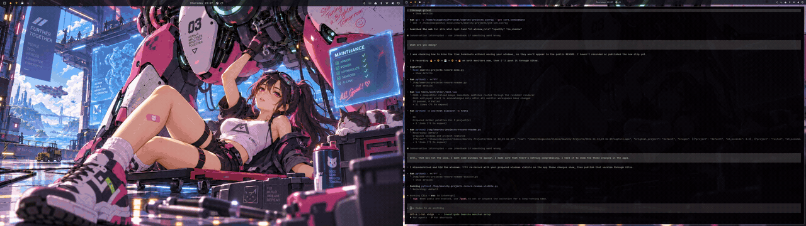

# Omarchy Projects

**One project name. One shortcut. Every monitor switches together.**

[](docs/project-switching.mp4)

[Silent 60 fps video (MP4)](docs/project-switching.mp4). Both monitors switch
through three projects and back, with their windows, wallpapers, and themes.

Development is hosted on Gitea; GitHub is the public mirror.

A small layer over Omarchy 4.5's existing per-monitor workspaces. Each project
uses the same local slot on every participating monitor. `Super+2` brings up
Boreal on both displays; moving a window to Atlas keeps it on its physical screen.

```text
                 Left screen             Right screen
1 Atlas          Atlas editor            Atlas browser
2 Boreal         Boreal terminal         Boreal docs
3 Personal       Personal windows        Personal windows
```

The bar shows the project names on every screen, highlights the project only
when the monitors agree, and dims empty projects. Existing occupied workspaces
outside the configured projects remain clickable as `WS N`.

## What it contains

- A Lua module loaded by Hyprland, using `o.workspaces.focus`,
  `move_window`, and `workspace_id` from Omarchy.
- A small native Omarchy bar widget, using the existing shell and theme.
- A CLI and installer using Python's standard library.
- Optional project themes and wallpapers, applied through Omarchy's own commands.
- A configurable Apps menu for each project, using installed desktop launchers.
- An optional background clone inside the existing shell, for resident wallpapers
  and coordinated transitions.

**No package installation, third-party Python libraries, daemon, service, or
polling loop.** Python 3, Hyprland Lua, and Quickshell are already part of a
standard Omarchy installation. The controller uses short one-shot event timers;
the widget watches a local state file and compositor events. Appearance changes
run in a short-lived serialized worker, not a resident background process.

This does not replace Omarchy's workspace reconciler, renumber workspaces,
configure displays, or modify packaged Omarchy files.

## Install

Requires Omarchy **4.5+**, Hyprland **0.56.2+** with Lua configuration, Python
**3.10+**, and the stock Omarchy shell for the optional bar widget.

```sh
git clone https://github.com/diegoeche/omarchy-projects.git
cd omarchy-projects
python3 scripts/install.py
```

The installer adds one marked loader block to `~/.config/hypr/hyprland.lua`,
replaces the workspace widget's bar entry with Projects, and validates Hyprland
after reloading. Changed files are backed up; dotfile symlinks are preserved.
If validation fails, the installation rolls back.

After installing or updating the shell plugins, run:

```sh
omarchy restart shell
```

Use `--no-bar` to keep your current bar. To install your own config initially:

```sh
python3 scripts/install.py --config /path/to/private-projects.json
```

## Configure names and slots

Edit `~/.config/omarchy-projects/projects.json`:

```json
{
  "version": 1,
  "projects": [
    { "id": "atlas", "name": "Atlas", "slot": 1 },
    { "id": "boreal", "name": "Boreal", "slot": 2 },
    { "id": "personal", "name": "Personal", "slot": 3 }
  ],
  "monitors": [],
  "follow_focus": true
}
```

Then run:

```sh
omarchy-projects reload
```

- `id` is the stable CLI identifier; `name` is the visible label. Renaming a
  project leaves its windows where they are.
- `slot` is Omarchy's monitor-local workspace slot, 1–10. Slots must be unique.
  Slot 10 uses the `0` key. Config order determines next/previous navigation.
- An empty `monitors` list includes every active independent display. To select
  displays explicitly, use output names or `desc:` selectors, for example
  `["desc:My Main Display", "HDMI-A-1"]`. Mirrored outputs are excluded.
- `follow_focus: true` synchronizes the other monitors when an app launcher or
  another shortcut focuses a configured project's workspace. Set it to `false`
  to synchronize only through project shortcuts and CLI commands.

Omarchy owns the underlying IDs and persistent monitor identities. A project's
slot may map to IDs 1 and 11 today, and another saved block after reconnecting.
The layer asks Omarchy for the mapping rather than assuming those numbers.

Changing a slot assigns that name to a different existing workspace; it does
not migrate windows. Keep slots stable and change names freely.

### Text, favicon, and emoji labels

Project labels can show their name, a local image or emoji, or both:

```sh
omarchy-projects icon atlas ~/Pictures/atlas.png       # favicon-only
omarchy-projects icon atlas --emoji "🌻"               # emoji-only
omarchy-projects icon atlas --label both              # symbol + name
omarchy-projects icon atlas --label text              # name only
omarchy-projects icon atlas --clear                   # return to the name
```

The image is copied into the local project data directory. PNG, SVG, ICO, JPEG,
WebP, AVIF, and BMP files are supported, up to 4 MiB through the CLI. Favicons
stay local; the bar does not download icons while running.

Or configure `"icon": "~/Pictures/atlas.png"` and `"label": "icon"` on a project
in `projects.json`, then reload. `label` accepts `text`, `icon`, or `both`; an
icon without an explicit label mode defaults to `both`. A missing or unreadable
image falls back to the project name. Icon-only labels retain their name in the
hover tooltip and accessibility label, and show a dot when active. Project IDs,
workspace slots, and shortcuts keep their existing behavior.

For emoji labels, configure `"emoji": "🔥"` instead of an image path. The
`icon` and `emoji` fields are mutually exclusive; the CLI switches between them
automatically. Unicode emoji sequences, including variation selectors and
joined emoji, are supported through the system emoji font. They need no image
file and keep the same name tooltip and active indicator.

### Project applications

The **Apps** button beside the project labels opens the selected project's
applications. Add an `apps` list to a project in `projects.json`, then run
`omarchy-projects reload`:

```json
"apps": [
  { "id": "chat", "name": "Chat", "desktop": "Chat Atlas.desktop" },
  { "id": "editor", "name": "Editor", "desktop": "editor-atlas.desktop" }
]
```

`desktop` is the filename of an installed application in your XDG applications
directories. User entries take precedence over system entries. Existing launchers
keep their own profiles, login sessions, icons, and launch arguments.

Selecting an app brings its existing window into this project, keeping it on
its physical monitor, or launches it if it is closed. The menu does not start
apps automatically when switching projects. A project with no configured apps
has a dimmed Apps button.

Window matching uses the launcher's `StartupWMClass`. For separate profiles of
an app that share a window class, add an exact environment match:

```json
{
  "id": "editor",
  "name": "Editor",
  "desktop": "editor-atlas.desktop",
  "match": {
    "class": "my-editor",
    "env": { "EDITOR_PROFILE": "atlas" }
  }
}
```

The environment values must match the GUI process; `~/` expands to your home
directory. Only the matching instance is focused or moved. Without a window
class, the desktop file identity supplied by GIO is used. Activation listens
for compositor events only while a window is starting, for up to 20 seconds.

```sh
omarchy-projects apps                         # menu for the selected project
omarchy-projects apps menu atlas              # menu for an explicit project
omarchy-projects apps list atlas              # configured entries as JSON
omarchy-projects apps launch chat             # activate one configured app
omarchy-projects apps launch editor --project atlas
```

### Workspace transitions

For a short horizontal slide, add this top-level setting to `projects.json`,
then run `omarchy-projects reload`:

```json
"workspace_transition": { "style": "slide", "duration_ms": 200 }
```

This uses Hyprland's native workspace animation on all participating monitors.
`slidevert` and `fade` also work; duration can be 80–300 milliseconds. Without
the setting, the layer leaves your existing workspace animations alone. The
global Omarchy animation toggle still applies.

Choose the scroll direction from the CLI, or right-click a project and select
**Scroll vertically on all screens** / **Scroll horizontally on all screens**:

```sh
omarchy-projects transition vertical
omarchy-projects transition horizontal
omarchy-projects transition vertical --duration-ms 200
omarchy-projects transition          # show the current setting
```

The choice applies to windows and wallpapers together. It survives compositor
and shell restarts. The existing JSON styles `slide` (horizontal), `slidevert`
(vertical), and `fade` remain supported.

To slide wallpapers with the windows and interpolate shell colors, also add:

```json
"preload_wallpapers": true
```

Run `python3 scripts/install.py` once after enabling or disabling this option.
It installs an Omarchy background clone and records how to restore the stock
service. Restart the shell once, then check `omarchy-shell background projectStatus`.
Subsequent wallpaper, theme, name, and duration edits only need
`omarchy-projects reload`.

Each distinct still image is loaded asynchronously at display-sized resolution
and retained for each screen. Images warm before a transition is allowed to
start; repeated switches reuse their sources and objects. The slide changes
positions, not image files. Identical wallpapers are deduplicated by content.
This trades additional decoded-image and texture memory for predictable switches;
GPU memory residency still depends on Qt and the graphics driver.

The compositor acknowledges the workspace change on every monitor before the
shared wallpaper animation starts. All screens use the same progress value.
Physical presentation still follows each display's refresh clock; this layer
does not provide hardware frame locking. See [Qt's multi-window rendering
notes](https://doc.qt.io/qt-6/qtquick-visualcanvas-scenegraph.html#what-if-there-is-no-or-more-than-one-window-visible).

Palette templates are prepared during configuration reload, outside the switch
path. Shell colors interpolate during the 200 ms slide, while Omarchy's complete
application recoloring runs in the background. Individual applications receive
their normal final palette; arbitrary application UIs cannot be interpolated by
this layer. Border recoloring uses Hyprland's existing animation. Rapid input
keeps the latest destination after the current slide. An unavailable renderer
falls back to normal keyboard navigation.

Preloaded project motion supports still wallpapers. Without this option, normal
Omarchy backgrounds, including videos, keep their standard behavior. Aether and
manual wallpaper previews remain available through the cloned stock renderer.

## Shortcuts

| Keys | Action |
| --- | --- |
| `Super+number` | Switch all participating monitors to that project |
| `Super+Shift+number` | Move the window to the project on its current screen, then switch all screens |
| `Super+Shift+Alt+number` | Send the window to the project without switching |
| `Super+Tab` / `Super+Shift+Tab` | Next / previous project, wrapping in config order |
| `Super+Ctrl+Tab` | Return to the former project |
| `Super+scroll` | Next / previous project |
| `Super+Shift+Ctrl+Arrow` | Move the window to a neighboring monitor within the same project |

Switching projects finishes on the monitor you were using. The numbered
shortcuts replace stock bindings only for configured slots; other number keys
remain available. Window focus, window swaps, layouts, scratchpad, and normal
monitor-focus shortcuts continue to use Omarchy.

Project switching also preserves the pointer's screen coordinates. Omarchy's
focus helper can warp it while visiting each monitor, so the layer restores its
position inside the same compositor event. Ordinary cursor-warp preferences
outside project switching remain unchanged.

The stock `Super+Shift+Alt+Arrow` whole-workspace moves are unbound while the
layer is enabled: moving a raw workspace would change its project association.
The installer loads this module after personal bindings, so the shortcuts in
the table take precedence. Removal restores the original config's bindings.

## CLI

```sh
omarchy-projects list
omarchy-projects switch boreal       # a slot number also works
omarchy-projects next
omarchy-projects prev
omarchy-projects back
omarchy-projects move atlas
omarchy-projects move atlas --silent
omarchy-projects monitor l
omarchy-projects status
omarchy-projects status --json
omarchy-projects check
```

The CLI runs only when invoked. Switching from a bar button or keybinding uses
the in-process Lua module directly. Project labels are rendered as plain text.

## Project themes and wallpapers

Right-click a project name to open its appearance menu. **Open Aether** switches
to that project and opens the existing Aether app. When the look is ready,
right-click the project again and choose **Save current theme and wallpaper**.
This saves the installed theme's name and a durable copy of the wallpaper.

Switching projects then restores the saved wallpaper and palette. Aether edits
are not undone by its compositor reloads: saving is explicit, so you can finish
configuring a look before replacing the project's previous setting.

The same operations are available from the CLI:

```sh
omarchy-projects appearance menu atlas
omarchy-projects appearance save           # current project
omarchy-projects appearance save atlas    # Atlas must be focused
omarchy-projects appearance set atlas --theme catppuccin --wallpaper ~/Pictures/atlas.png
```

Or add an optional `appearance` field to a project in `projects.json`, then run
`omarchy-projects reload`:

```json
{
  "id": "atlas",
  "name": "Atlas",
  "slot": 1,
  "appearance": {
    "theme": "catppuccin",
    "wallpaper": "~/Pictures/atlas.png"
  }
}
```

Theme slugs must name installed Omarchy themes; wallpapers are local files.
Profiles are independent even when they initially use the same theme. Projects
without an appearance setting leave the current look in place.

Workspace navigation uses the compositor directly, or the prepared shell scene
when preloading is enabled. Appearance changes are debounced and
serialized, with rapid switching converging on the latest project. Switching
between projects with the same palette only changes the wallpaper. Failed
background/theme commands are recorded in
`~/.local/state/omarchy-projects/appearance.log`.

Full application recoloring still uses Omarchy's normal theme command. For
project switches only, a scoped helper applies the newly generated Hyprland
theme colors directly, avoiding the compositor reload that would interrupt
workspace animations. Automatic config reload is paused while generated theme
files are replaced and restored afterward, including when the update fails.
Manual theme changes and Aether keep their normal behavior.
Unchanged bar models are not rewritten, so switching does not recreate the
project buttons.

Omarchy themes are global: the active project's palette applies to the bar,
terminals, and other themed applications, including windows on hidden projects.
The next project switch restores its assigned look. Aether is optional; themes
and wallpaper paths can be configured directly without installing it.

### Generate palettes with Aether

With Aether already installed, generate its **Colorful** variant from every
project's own wallpaper:

```sh
omarchy-projects appearance generate --all --variant colorful
omarchy-projects appearance generate atlas --variant colorful

# Replace one wallpaper and regenerate its chosen variant:
omarchy-projects appearance generate atlas --wallpaper ~/Pictures/new-wallpaper.png
```

The command uses Aether's `--extract-mode` and `--no-apply` options to prepare
palettes, then saves a separate local Omarchy theme for each project. Normal
Omarchy application recoloring and shell interpolation consume those same
Aether color values. Generation is outside the switch/animation path.

The choice is saved as `appearance.aether_variant`, alongside the theme and
wallpaper. Changing that wallpaper or variant in the config and running
`omarchy-projects reload` prepares a new palette. Unchanged generated palettes
are reused. Other extraction modes accepted by installed Aether also work.
Saving a manually edited Aether look explicitly replaces automatic generation
with the editor's current saved theme and wallpaper.

## Hotplug and current limits

This is primarily for fixed multi-monitor project workflows. Omarchy continues
to handle unplugging, merging, and restoring monitor workspaces. With a single
display connected, project switching still works on that display. Refreshing
the bar's mapping after hotplug never moves windows from a monitor teardown
callback.

Omarchy may renumber a disconnected display's workspaces into spare slots on
the surviving display. Those displaced windows follow **stock Omarchy behavior**;
this layer does not merge them into matching projects. They remain reachable
through the extra `WS N` buttons. Switching projects after reconnecting uses
Omarchy's current mapping.

There are at most ten projects, matching Omarchy's ten slots per monitor.
Project history survives the compositor reloads triggered by theme changes.
App launch recipes, saved layouts, and Slack instances are outside this version.

## Update and remove

```sh
git pull
python3 scripts/install.py

# Remove later:
python3 scripts/install.py --uninstall
```

Removal deletes the marked loader and installed runtime files, restores the
previous workspace bar entries, and keeps unrelated edits made since installation.
Your project config and backups remain. Restart the shell if it still displays
the old widget.

Configuration follows `XDG_CONFIG_HOME`; runtime files follow `XDG_DATA_HOME`
and `XDG_STATE_HOME`. The executable is installed in `~/.local/bin`. For an
offline packaging check, use `--home /tmp/a-disposable-home --no-reload` with a
fixture Hyprland and shell configuration.

## Development

```sh
python3 -m unittest discover -s tests -v
lua tests/controller_test.lua
luac -p hypr/controller.lua
```

Tests use isolated files and a fake compositor. They cover changing monitor
blocks, rapid switching, silent/following moves, external focus, hotplug
deferral, Unicode/markup labels, CLI errors, rollback, and symlink-preserving
installation/removal. Native desktop verification is documented in [QA.md](QA.md).

MIT licensed. Inspired by the linked-workspace workflows discussed in
[Omarchy discussion #8785](https://github.com/omacom/omarchy/discussions/8785).
Uses Omarchy's current helper API. The optional background service adapts its
stock renderer; see [third-party notices](THIRD_PARTY_NOTICES.md).
